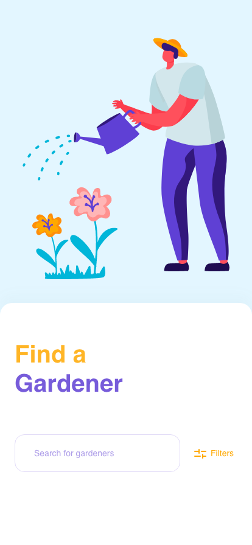

# Flutter UI Reality

[](https://github.com/okok147/Flutter-UI-Reality/actions/workflows/flutter.yml)
[](LICENSE)

Practical Flutter UI implementations preserved and modernized as an open-source learning and reference collection.

Flutter UI Reality began in 2019 as a public record of turning visual designs into working Flutter interfaces. Maintenance resumed in 2026 with an explicit distinction between examples verified on current Flutter and examples preserved as legacy learning material.

## Community adoption

As of **11 August 2026**, this repository has **157 GitHub stars and 50 forks**. These figures show historical community interest; they are not download counts or evidence that every example is production-ready.

## Examples

| Example | Preview | Maintenance status |
| --- | --- | --- |
| [Gardener](gardener_01/) |  | **Maintained.** Modernized for Flutter 3.44 and Dart 3.12, with current platform scaffolding and automated tests. The web release build is verified. |
| [Friendly Forest](friendly_forest_02/) |  | **Legacy.** Historical Dart 2 example; migration is planned. |
| [Market App](market_app_03/) |  | **Legacy.** Historical Dart 2 example; migration is planned. |
| [Application Activity](mobile_application_activity_04/) |  | **Legacy.** Historical Dart 2 example; migration is planned. |
| [Testing sandbox](testing/) | — | **Legacy.** Early experimentation project, retained for historical context. |

## Run the maintained example

Install [Flutter 3.44 or newer](https://docs.flutter.dev/get-started/install), then:

```sh
cd gardener_01
flutter pub get
flutter run
```

Validate the same example locally:

```sh
dart format --output=none --set-exit-if-changed lib test
flutter analyze
flutter test
flutter build web --release
```

The four legacy examples use pre-null-safety Dart constraints and do not currently resolve on stable Dart 3. Their screenshots and implementation history remain useful references, but their README files carry an explicit compatibility notice.

## Maintenance roadmap

1. Keep Gardener green on stable Flutter through CI and dependency review.
2. Migrate Friendly Forest as the next complete example, including asset provenance review.
3. Migrate Market App and Application Activity with coordinated dependency and API changes.
4. Decide whether the testing sandbox should become a real example or move to an archive branch.
5. Publish versioned releases only after the documented validation gates pass.

See [MAINTENANCE.md](MAINTENANCE.md), [CHANGELOG.md](CHANGELOG.md), and the [August 2026 maintenance audit](docs/maintenance/2026-08-audit.md) for scope and evidence.

## Contributing and security

Issues and focused pull requests are welcome. Read [CONTRIBUTING.md](CONTRIBUTING.md) before proposing a migration or adding assets. Report suspected vulnerabilities through the process in [.github/SECURITY.md](.github/SECURITY.md), not a public issue.

## License and asset provenance

Repository-authored source code and documentation are available under the [MIT License](LICENSE), subject to the exclusions described in [THIRD_PARTY_NOTICES.md](THIRD_PARTY_NOTICES.md). Historical screenshots, animations, fonts, design references, and other third-party assets are **not automatically covered by the MIT License**. Review their provenance before reuse.
