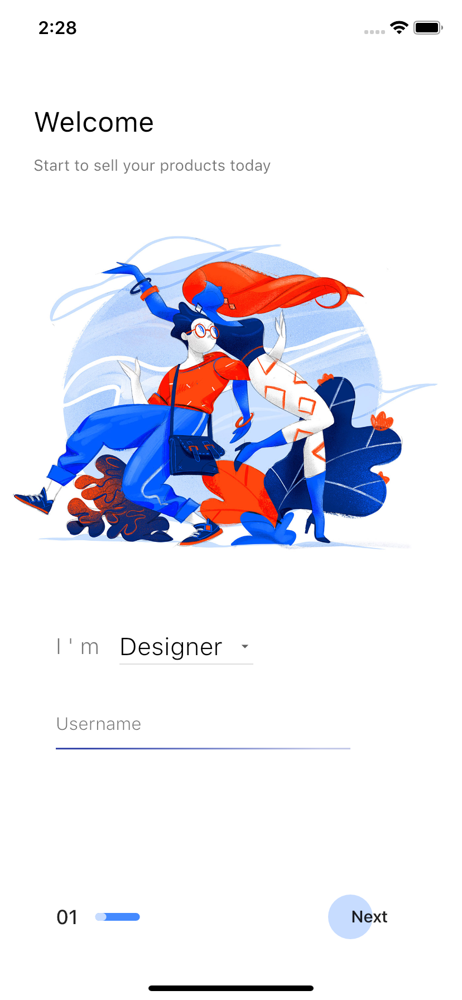

# Market App UI

> **Legacy compatibility notice:** This historical example uses a Dart 2, pre-null-safety dependency set and does not currently resolve on stable Dart 3. Its visuals are retained as a learning reference. A coordinated migration is planned; see the root [maintenance policy](../MAINTENANCE.md).

Simplicity and beauty. Based on this historical [design reference](https://dribbble.com/shots/6525264-UI-Market-app).

 

Historical process preview:

